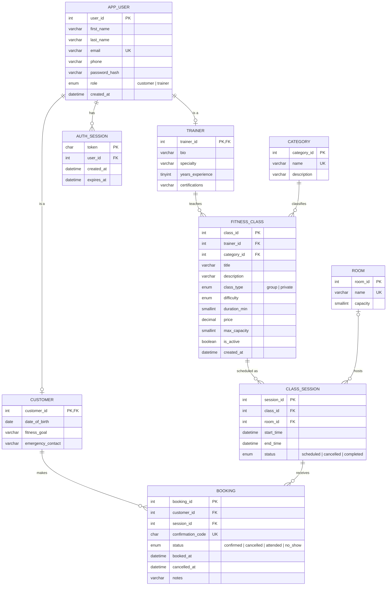

# FitZone Training (FZT): Fitness Class Scheduling & Booking System
## Database Design Document: Project C, Task 1

---

## 1. Database Requirements Collection

### 1.1 Business overview
FitZone Training offers **group fitness classes** and **private (1-on-1) training sessions**. The current
scheduling process is manual. The new web system lets **customers** browse and book sessions and lets
**trainers** create and manage their own classes, schedules, and bookings.

### 1.2 Users / actors
| Actor | What they do in the system |
|---|---|
| **Customer** | Registers, logs in, maintains a profile (DOB, fitness goal, emergency contact), searches classes, books a session, views upcoming bookings and booking history, cancels bookings. |
| **Trainer** | Registers, logs in, maintains a profile (bio, specialty, experience, certifications), creates/edits/deletes classes, schedules sessions (one-time or weekly repeating), reschedules or cancels sessions, views rosters, marks attendance (attended / no-show), and cancels customer bookings. |

### 1.3 Data requirements (what must be stored)
- **Users**: every user has a first name, last name, unique email, phone, hashed password, role, and account-created date.
  A user is **either** a customer **or** a trainer (disjoint, total specialization).
- **Customers**: date of birth, fitness goal, emergency contact.
- **Trainers**: bio, specialty, years of experience, certifications.
- **Categories**: type of workout (Yoga, HIIT, Strength, Cycling, Pilates, Boxing, Personal Training). Name is unique.
- **Rooms**: name and maximum capacity of each workout space.
- **Classes**: created by exactly one trainer and belonging to one category. Title, description, class type
  (group or private), difficulty (Beginner/Intermediate/Advanced), duration, price, max capacity, and active flag.
- **Sessions**: a specific scheduled occurrence of a class with a start and end time, an optional room, and a
  status (scheduled, cancelled, completed). A class can have many sessions.
- **Bookings**: a customer reserving a spot in a session. Stores a unique confirmation code, status
  (confirmed, cancelled, attended, no_show), booked date/time, cancelled date/time, and optional notes.
- **Login sessions (auth tokens)**: a token per login, tied to one user, with an expiration date.

### 1.4 Business rules
1. An email address can only be registered once.
2. Every class is owned by exactly one trainer; trainers can only edit their own classes and sessions.
3. A **private** class always has a capacity of 1. A group class has a capacity from 1 to 100.
4. A session's end time must be after its start time (end = start + class duration).
5. A trainer cannot teach two sessions at overlapping times, and a room cannot hold two overlapping sessions.
6. A session's room must be large enough for the class capacity.
7. A customer can book a session only if it is scheduled, in the future, and has seats left
   (confirmed + attended bookings < capacity).
8. A customer can have at most one booking per session, and can't book two overlapping sessions.
9. Customers can cancel a confirmed booking any time before the session starts. A cancelled booking can be re-booked.
10. Trainers record attendance (attended / no-show) only after a session has started.
11. When a trainer cancels a session, all confirmed bookings for it are cancelled.
12. A class with booking history is **archived** (inactive) instead of deleted, so customer history is preserved.

### 1.5 Functional requirements → system features
| Required function | Implemented features |
|---|---|
| User Management | Register (customer/trainer), login/logout with secure tokens, view/edit profile, change password |
| Class Listing & Management | Trainers create, read, edit, delete/archive classes; add one-time or weekly-repeating sessions; reschedule, cancel, delete sessions |
| Search & Filtering | Keyword search (title, description, category, trainer); filter by category, type, difficulty, trainer, date range; sort by next available, name, price low→high / high→low, popularity, duration |
| Customer Booking Management | Book a session, receive confirmation code, view upcoming bookings, view booking history, cancel bookings |
| Trainer Booking Management | Dashboard stats, schedule (upcoming/past), roster per session, bookings list with search/filter, mark attended / no-show, cancel a booking |

---

## 2. Entity-Relationship Diagram (ERD)

### 2.1 Entities and relationships
| Relationship | Cardinality | Participation |
|---|---|---|
| USER **is a** CUSTOMER / TRAINER | Supertype/subtype (disjoint, total) | Every user is exactly one subtype |
| TRAINER **teaches** FITNESS_CLASS | 1 : M | A trainer may have 0..M classes; a class must have exactly 1 trainer |
| CATEGORY **classifies** FITNESS_CLASS | 1 : M | A category may have 0..M classes; a class must have exactly 1 category |
| FITNESS_CLASS **is scheduled as** CLASS_SESSION | 1 : M | A class may have 0..M sessions; a session belongs to exactly 1 class |
| ROOM **hosts** CLASS_SESSION | 1 : M | A room may host 0..M sessions; a session has 0..1 room |
| CUSTOMER **books** CLASS_SESSION | M : N, resolved by **BOOKING** | A customer may have 0..M bookings; a session may have 0..M bookings |
| USER **has** AUTH_SESSION | 1 : M | A user may have 0..M login tokens; a token belongs to 1 user |

### 2.2 ERD (crow's foot)

> To draw this in ERDPlus or draw.io, use the entity and relationship tables above. The Mermaid
> diagram renders automatically on GitHub and in VS Code's Markdown preview.

---

## 3. Relational Schema

Notation: **PK** is underlined/bold, *FK* is italic with its referenced table.

- **APP_USER** (<u>**user_id**</u>, first_name, last_name, email *(unique)*, phone, password_hash, role, created_at)
- **CUSTOMER** (<u>***customer_id***</u>, date_of_birth, fitness_goal, emergency_contact)
  - customer_id → APP_USER(user_id)
- **TRAINER** (<u>***trainer_id***</u>, bio, specialty, years_experience, certifications)
  - trainer_id → APP_USER(user_id)
- **AUTH_SESSION** (<u>**token**</u>, *user_id*, created_at, expires_at)
  - user_id → APP_USER(user_id)
- **CATEGORY** (<u>**category_id**</u>, name *(unique)*, description)
- **ROOM** (<u>**room_id**</u>, name *(unique)*, capacity)
- **FITNESS_CLASS** (<u>**class_id**</u>, *trainer_id*, *category_id*, title, description, class_type, difficulty, duration_min, price, max_capacity, is_active, created_at)
  - trainer_id → TRAINER(trainer_id)
  - category_id → CATEGORY(category_id)
- **CLASS_SESSION** (<u>**session_id**</u>, *class_id*, *room_id*, start_time, end_time, status)
  - class_id → FITNESS_CLASS(class_id)
  - room_id → ROOM(room_id) *(nullable)*
- **BOOKING** (<u>**booking_id**</u>, *customer_id*, *session_id*, confirmation_code *(unique)*, status, booked_at, cancelled_at, notes)
  - customer_id → CUSTOMER(customer_id)
  - session_id → CLASS_SESSION(session_id)
  - UNIQUE (customer_id, session_id)

### 3.1 Constraints implemented in MySQL
| Table | Constraint | Purpose |
|---|---|---|
| app_user | `UNIQUE(email)` | Rule 1 |
| fitness_class | `CHECK (max_capacity >= 1)`, `CHECK (price >= 0)` | Valid values |
| fitness_class | `CHECK (class_type = 'group' OR max_capacity = 1)` | Rule 3: private = 1 person |
| class_session | `CHECK (end_time > start_time)` | Rule 4 |
| booking | `UNIQUE(customer_id, session_id)` | Rule 8: one booking per session |
| booking | `UNIQUE(confirmation_code)` | Codes identify a booking |
| customer / trainer | FK `ON DELETE CASCADE` to app_user | Subtype rows removed with the user |
| class_session | FK room `ON DELETE SET NULL` | Removing a room doesn't delete history |

Rules that depend on other rows (5, 6, 7, 9, 10, 11, 12) are enforced in the C# API inside database
**transactions**. Booking locks the session row with `SELECT ... FOR UPDATE` so two customers can't take the last seat at the same moment.

### 3.2 Normalization
- **1NF**: every column holds one atomic value; no repeating groups (e.g. sessions are rows in CLASS_SESSION, not columns on a class).
- **2NF**: every table has a single-column surrogate primary key, so there are no partial dependencies.
- **3NF**: no transitive dependencies. Trainer details live in TRAINER, not repeated on each class; category
  names live in CATEGORY; room capacity lives in ROOM. Seats left are **calculated**, not stored, in the view
  `v_session_availability`, so they can't get out of sync.
- The supertype/subtype design keeps customer-only and trainer-only attributes out of APP_USER, so there are no columns that are always NULL for one role.

### 3.3 View
`v_session_availability`: one row per session with `booked_count` (confirmed + attended bookings) and
`seats_left = max_capacity - booked_count`. Used by the class detail page and the trainer schedule.

---

## 4. Data Loading
`database/data_loading_queries.sql` loads:

| Table | Rows |
|---|---|
| app_user | 22 (5 trainers, 17 customers) |
| trainer / customer | 5 / 17 |
| auth_session | 5 |
| category | 7 |
| room | 5 |
| fitness_class | 14 (10 group, 4 private) |
| class_session | ~155 (generated from a weekly timetable, 2 weeks back to 3 weeks ahead of the load date) |
| booking | ~900 (attended / no-show for past sessions; confirmed / cancelled for upcoming ones) |

Sessions are generated with a **recursive CTE** relative to `CURDATE()`, so re-running the script always gives
current upcoming classes. Bookings are generated with `ROW_NUMBER() OVER (PARTITION BY session_id ...)` to fill each
session to a realistic level without going over capacity.

All seeded accounts use the password **`Password123!`** (stored as a PBKDF2-SHA256 hash).
